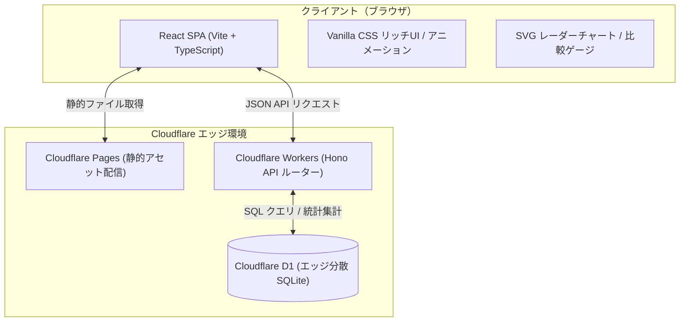

# アーキテクチャ設計書（Architecture Design）

`bukka_now` のシステム構成、ディレクトリ構造、およびクライアント/サーバー間の通信設計を定義します。

---

## 1. 全体構成図（System Architecture）



- **Cloudflare Pages**: フロントエンド（React + Vite）の静的ビルド成果物を世界中のエッジロケーションから超高速配信。
- **Hono on Cloudflare Workers / Pages Functions**: 超軽量・型安全な REST API サーバー。設問配信、スコアリング判定、回答データの非同期集計処理を担当。
- **Cloudflare D1**: サーバーレス分散 SQLite データベース。ユーザーの匿名回答ログを蓄積し、全問の「世間の平均予想」をリアルタイムに計算・提供。

---

## 2. ディレクトリ構成

単一リポジトリ（Monorepo風または統合フルスタック構成）として保守しやすく整理します。

```
bukka_now/
├── .agents/                    # エージェント用ルール・スキル定義
├── docs/                       # プロジェクト公式ドキュメント
│   ├── README.md               # ドキュメント目次
│   ├── requirements/           # 要件定義
│   ├── design/                 # 詳細設計書
│   └── devlog/                 # 開発日報
├── migrations/                 # Cloudflare D1 SQLマイグレーションファイル
│   └── 0001_initial_schema.sql # テーブル作成および初期マスター投入
├── functions/                  # Cloudflare Pages Functions (API エントリポイント)
│   └── api/
│       └── [[route]].ts        # Hono ルーター
├── src/                        # フロントエンド (React)
│   ├── components/             # UIコンポーネント (クイズカード, レーダーチャート等)
│   │   ├── Header.tsx
│   │   ├── QuizCardChoice.tsx  # 4択コンポーネント
│   │   ├── QuizCardSlider.tsx  # ニアピンスライダー
│   │   ├── QuizCardCompare.tsx # 過去比較コンポーネント
│   │   ├── ResultDashboard.tsx # 診断結果・スコアダッシュボード
│   │   ├── RadarChart.tsx      # SVGレーダーチャート
│   │   └── ComparisonBar.tsx   # あなた vs 世間 vs 相場 比較バー
│   ├── data/                   # クイズマスターデータ定義 (TypeScript)
│   ├── hooks/                  # カスタムフック (クイズ状態管理, API通信)
│   ├── styles/                 # Vanilla CSS
│   │   ├── index.css           # リセット・変数・カラーパレット
│   │   ├── components.css      # コンポーネント用スタイル
│   │   └── animations.css      # アニメーション定義
│   ├── types/                  # 共通型定義 (Quiz, Answer, Result)
│   ├── App.tsx                 # メインアプリ画面
│   └── main.tsx                # エントリポイント
├── server/                     # Hono バックエンド実装
│   ├── index.ts                # Hono アプリケーション定義
│   ├── routes/                 # 各APIルート (quiz, stats)
│   └── services/               # スコアリングロジック・D1操作
├── public/                     # 静的アセット (ファビコン, OGP画像)
├── wrangler.toml               # Cloudflare 設定ファイル (D1 バインディング等)
├── vite.config.ts              # Vite 設定
├── package.json
└── tsconfig.json
```

---

## 3. 通信・データフロー設計

### 3.1 クイズ開始時
1. クライアントが `GET /api/quiz` を呼び出す。
2. APIは、全7問の出題データ（設問文、選択肢、カテゴリ等）と、現在の「世間の平均予想データ」を返却。正解価格はカンニング防止のためこの段階ではクライアントに送信しない。

### 3.2 回答完了・採点送信時
1. クライアントが全7問のユーザー回答配列を `POST /api/quiz/submit` へ送信。
2. サーバー側（Hono）で：
   - 物価マスターデータの正解価格と照合し、各問の誤差率とスコア（0〜100点）を計算。
   - 回答傾向から「物価感覚タイプ（4タイプ）」を判定。
   - カテゴリ別スコアを計算。
   - 回答ログを Cloudflare D1 に非同期 INSERT し、各設問の平均予想値を更新。
3. サーバーから採点結果（総合スコア、タイプ、レーダーチャート値、各問の「あなたの回答」「世間平均」「実際の公的価格」「解説」）を返却。
4. クライアントはアニメーション演出を伴って結果ダッシュボードを表示。
