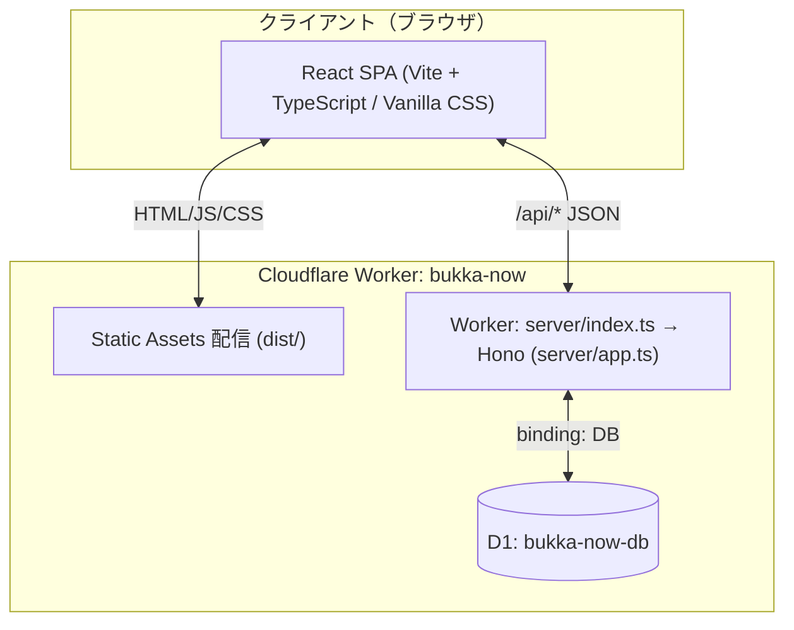

# アーキテクチャ設計書（Architecture Design）

`bukka_now` のシステム構成、ディレクトリ構造、およびクライアントとサーバー間の通信設計を定義します。

---

## 1. 全体構成図（System Architecture）



- **Workers Static Assets**: Vite のビルド成果物（`dist/`）を配信する。存在しないパスは `index.html` を返す（`not_found_handling = "single-page-application"`）。`dist/index.html` にはビルド時にトップ画面の HTML を書き込んである（プリレンダー。[seo.md](seo.md)）。
- **Worker + Hono**: `wrangler.toml` の `assets.run_worker_first = ["/api/*"]` により、`/api/*` へのリクエストだけが Worker（`server/index.ts`）に届き、`server/app.ts` の Hono アプリが処理する。出題、採点、集計、D1 への保存を担当する。それ以外のリクエストは Worker を起動せずにアセットとして返る。
- **Cloudflare D1**: 匿名の回答ログと設問別の集計を保存する。スキーマは [database.md](database.md) を参照。
- **デプロイ方式**: Git 連携ではなく `npm run deploy`（`wrangler deploy`）で手動反映する。
- **ドメイン**: `bukka-now.miiiwa.com` を Worker の Custom Domain として接続する（`wrangler.toml` の `routes`）。`*.workers.dev` も有効にしてある。

---

## 2. ディレクトリ構成

```
bukka_now/
├── AGENTS.md                   # AI エージェント用プロジェクト指示
├── docs/                       # ドキュメント（目次: docs/README.md）
├── server/                     # API 実装（Hono）
│   ├── index.ts                # Worker エントリ（Hono アプリを default export）
│   ├── app.ts                  # ルーティング・D1 アクセス・集計
│   ├── scoring.ts              # 採点・パーセンタイル・分布生成・タイプ判定
│   ├── aggregation.ts          # 集計対象（正解の 1/5〜5倍）の判定。API・scripts で共通
│   └── types.ts                # Env（D1 バインディング）型
├── migrations/
│   ├── 0001_initial_schema.sql # D1 スキーマ（シードデータなし）
│   ├── 0002_add_submission_source.sql # quiz_submissions.source（実ユーザー / 生成データの区別）
│   └── 0003_in_range_and_score_counts.sql # 未回答の除去・集計対象・最低値/最高値・スコア分布
├── src/                        # フロントエンド（React）
│   ├── App.tsx                 # 画面遷移（landing / quiz / result）・10秒タイマー・API 呼び出し
│   ├── main.tsx
│   ├── index.css               # Vanilla CSS（unpis 風デザインシステム）
│   ├── components/
│   │   ├── Header.tsx                # ロゴ（<button>）・「最初に戻る」
│   │   ├── ConfirmDialog.tsx         # 確認ダイアログ（<dialog>。クイズ中にトップへ戻るとき）
│   │   ├── InlineNotice.tsx          # 画面内のお知らせ（取得・送信の失敗。alert() の代わり）
│   │   ├── LandingView.tsx           # トップ（累計回答者数・設問数選択）
│   │   ├── NumberKeypad.tsx          # テンキー＋物理キーボード入力
│   │   ├── ResultDashboard.tsx       # 結果画面（固定スコアカード＋3面スライド・ジェスチャー）
│   │   ├── DistributionBarChart.tsx  # 面1: 10分割ヒストグラム
│   │   ├── DetailedPlotChart.tsx     # 面2: 1単位プロット
│   │   ├── PriceTrendChart.tsx       # 面3: 物価推移折れ線（SVG）
│   │   └── PriceNoteColumn.tsx       # 3面共通の「コラム」（priceNote）
│   ├── utils/format.ts         # 結果画面の金額表示（未回答・集計対象なしの表示）
│   ├── data/quizMaster.ts      # 100問マスター（正解価格・推移・コラム）＋ SENSE_TYPES。scripts/quiz-data で生成
│   └── types/quiz.ts           # フロント・サーバー共通型
├── scripts/quiz-data/          # 小売物価統計調査からクイズマスターを生成するスクリプト（Python）
├── scripts/synthetic-data/     # 架空の回答者の回答を生成し D1 に投入・削除するスクリプト（TypeScript）
├── scripts/db/                 # 集計対象の付け直しと集計の作り直し（npm run db:refresh:*）
├── scripts/seo/                # プリレンダー（build の最後に実行）・OGP 画像とアイコンの生成
├── public/                     # favicon・apple-touch-icon・OGP 画像・robots.txt・sitemap.xml
├── wrangler.toml               # Worker 設定（エントリ・Static Assets・ドメイン）・D1 バインディング
├── vite.config.ts              # React + @hono/vite-dev-server（dev 時に /api を Hono へ）
└── package.json
```

`src/data/` と `src/types/` はサーバーとフロントで共有している。サーバーは `src/data/quizMaster.ts` を import して採点する。

---

## 3. 実行環境ごとの API / DB の動き

| コマンド | フロント | API | D1 |
| :--- | :--- | :--- | :--- |
| `npm run dev` | Vite dev server（:5173） | `@hono/vite-dev-server` が `server/app.ts` を直接実行 | **バインディングなし**（`c.env.DB` は undefined）。保存はせず、集計値は空として動く |
| `npm run preview` | `dist/`（Static Assets） | `wrangler dev` が Worker（`server/index.ts`）を実行 | ローカル D1（`.wrangler/state`）。`wrangler.toml` のバインディングを使う。事前に `npm run db:migrate:local` が必要 |
| 本番 | Workers Static Assets | Worker | 本番 D1 `bukka-now-db` |

API は `c.env.DB` がない場合でも落ちないように作ってある。その場合は集計値が空（回答者0人。結果画面の世間平均は自分の回答のみから計算、上位%は 50%）として動く。回数制限のバインディング（`SUBMIT_RATE_LIMITER` / `READ_RATE_LIMITER`）がない場合は制限しない。

---

## 4. 通信・データフロー

### 4.1 起動時・トップ画面
1. 本番では、プリレンダー済みの HTML がまず表示され、`src/main.tsx` の `hydrateRoot` が React に引き継ぐ。
2. `App.tsx` がマウント時に `GET /api/quiz?count=10` を呼び、`totalParticipants`（累計回答者数）だけを使う。

### 4.2 クイズ開始時
1. `GET /api/quiz?count=N` を呼ぶ。
2. サーバーは `QUIZ_MASTER` をシャッフルして N 問を抽出する。返すのは表示に必要な項目（ID、カテゴリ、設問文、単位）と `totalResponses`（設問別回答者数）だけ。正解（`actualPrice`）、解説（`priceNote`）、正解のヒントになる値（`priceHistory`、世間平均）は返さない。

### 4.3 回答完了・採点時
1. クライアントが `POST /api/quiz/submit` に `{ answers: [{ questionId, answer }] }` を送る。時間切れで入力がない設問は `answer: null`（未回答）。
2. サーバー側の処理:
   - IP ごとの回数制限を確認する（超えたら 429）。
   - 入力を検証する（不正なら 400）。
   - D1 から1往復（`db.batch()`）で読む: 出題した設問の `item_aggregates`（回答数・集計対象の合計・最低値・最高値）、`score_counts`（総合スコアの分布）、設問ごとの直近500件の回答。
   - `calculateQuizResult()` で採点、パーセンタイル、タイプ判定、分布生成を行う。未回答は0点。世間平均・最低値・最高値は集計対象（正解の 1/5〜5倍）の回答だけで出し、今回の回答も対象なら含める。
   - D1 に保存する（`quiz_submissions` を INSERT、`score_counts` を UPSERT、回答した設問ごとに `quiz_answers` を INSERT・`item_aggregates` を UPSERT）。保存は `db.batch()` で1トランザクションにまとめ、`executionCtx.waitUntil` で非同期に行う（レスポンスを待たせない）。
3. 採点結果を返し、クライアントが結果画面を描画する。

API の詳細は [api.md](api.md) を参照。

---

## 5. 既知の課題

### 未解決（2026-10-11 時点）

| # | 課題 | 補足 |
| :--- | :--- | :--- |
| 1 | 画面の回答者数・分布の大半が生成データだが、画面に注記がない | 集計に含めるのは開発者の決定（[decisions.md](../requirements/decisions.md)）。注記を出すか、回答者数だけ実ユーザーで数えるかは未決定 |
| 2 | 自動テストと CI がない | 採点ロジック・入力検証・プリレンダー・画面操作が手動確認のみ |
| 3 | 回数制限は IP（IPv6 は /64）ごと・拠点ごとなので、多数の IP からの送信は防げない | D1 無料プランの書き込み上限（1日10万行）は、100問の送信約250回で使い切る。対策候補は Cloudflare Turnstile（いたずらの気配があったとき、または広く告知する前に検討） |

### 解決済み（2026-10-11）

| # | 課題 | 対応 |
| :--- | :--- | :--- |
| 1 | `PriceTrendChart.tsx` が `QUIZ_MASTER` を import しており、正解価格がクライアントバンドルに入っていた | import を削除し、採点 API が返す `pastPrice` / `pastPriceYear` だけを使うようにした。`pastPrice` / `pastPriceYear` は型上も必須にした |
| 2 | 出題 API が、回答0件の設問の `averageExpected` として正解価格を返していた。`pastPrice` も返していた | 出題 API から `averageExpected` と `pastPrice` / `pastPriceYear` を削除した（フロントでは未使用だった）。`GET /api/stats` からも正解価格と乖離率を削除した（乖離率から正解を逆算できるため） |
| 3 | 過去回答の取得が全設問合計で `LIMIT 500` だった | `ROW_NUMBER() OVER (PARTITION BY question_id)` で設問ごとに直近500件を取るようにした。回答者数は `item_aggregates`、最低値・最高値は SQL の `MIN` / `MAX` から全件ベースで出す |
| 4 | `POST /api/quiz/submit` の入力検証が不十分だった | 件数1〜100、存在する設問ID、重複なし、回答は 0〜99,999,999 の整数、を検証し、違反時は 400 を返す（その後、0円は不可・未回答は `null` に変更。#5） |
| 5 | 時間切れの未回答が 0円として保存され、世間平均・最低値を下げていた（本番の実ユーザー1件で10問すべて0円） | 未回答は `null` で送り、0点として採点するが保存しない。API は 0円を受け付けない。migration 0003 で既存の 0円の行を削除した |
| 6 | 1回の送信（例: 99,999,999円）で世間平均を壊せた。送信回数の制限がなく、CORS が全オリジン許可だった | 世間平均・最低値・最高値は正解の 1/5〜5倍の回答だけで出す（`in_range`）。IP ごとの回数制限（送信1分6回・読み取り1分60回）。CORS を外した |
| 7 | 採点1回の読み取りが、回答が増えるほど増えていた（10問で約2.5万行。全回答を読んで直近500件に絞り、最低値・最高値も全件から出していた）。トップ表示のたびに `COUNT(*)` で全診断を読んでいた | 最低値・最高値は `item_aggregates`、累計回答者数は `score_counts` から取る。過去回答は設問ごとに `ORDER BY id DESC LIMIT 500` でインデックスから読み止める |
| 8 | 「上位何%」が固定の正規分布モデル（μ=65, σ=16）で、実際の回答者と比べていなかった（画面は「リアルタイム回答分布から測定」と表示） | `score_counts`（総合スコアの分布）と比べた順位にした |
| 9 | 最終問題の送信が失敗（429 / 500）すると、10秒タイマーが再スタートして時間切れで自動再送信していた。理由を伝えず、手動の再送信もできなかった（429 の間は「10秒ごとにアラート → 再送信」を繰り返した） | 失敗したらタイマーを止め、画面内に理由と「もう一度送信」を出す。回答は保持する |
| 10 | ロゴ・「最初に戻る」で、クイズ途中でも確認なしにトップへ戻り、回答が消えた。ロゴは `<div role="button">` で Enter キーが効かなかった | クイズ中は確認ダイアログ（`<dialog>`）を出す。ロゴを `<button>` にした |
| 11 | テンキーが window 全体のキーを受けていたため、Esc でダイアログを閉じられず、ほかのボタンにフォーカスしても Enter が「回答の決定」になった | ダイアログ中はテンキーを無効化。テンキー以外のボタン・リンクにフォーカスがあるときの Enter はそのボタンに任せる |
| 12 | Vite テンプレートの未使用ファイル（`src/App.css`、`src/assets/*`、`public/icons.svg`）が残っていた | 削除した |
| 13 | 出題のシャッフルが偏っていた（お米 23.4%、末尾の品目 約7%。均等なら10%） | Fisher–Yates に置き換えた（20万回試して全問 9.9〜10.2%） |
| 14 | エラー表示が `alert()` だった | 画面内のお知らせ（`InlineNotice`）に置き換えた |
| 15 | 回数制限が IPv6 のアドレス単位で、付け替えで回避できた | IPv6 は /64 単位で数える |
