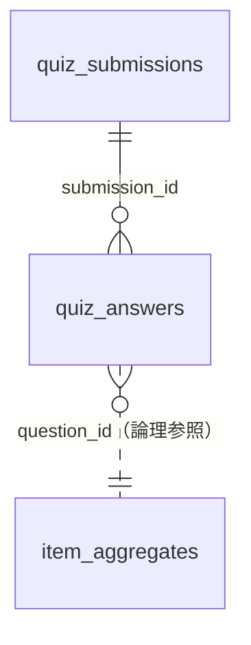

# データベース設計書（Database Design）

Cloudflare D1（エッジ分散型 SQLite）のテーブル構成、インデックス、およびクエリ仕様を定義します。
正となる定義は `migrations/` 配下の SQL（`0001_initial_schema.sql` → `0002_add_submission_source.sql` の順に適用）です。

---

## 1. 概要

- データベース名: `bukka-now-db`（バインディング名 `DB`、設定は `wrangler.toml`）
- ユーザー登録はないため、個人を識別する情報は保存しない。
- 保存するのは「診断1回分の結果」「設問ごとの回答」「設問別の集計」の3種類。
- 世間平均・分布・回答者数は、D1 に入っている回答から作る。コードや migration に値を直接書いたシードは入れない。
- 実ユーザーの回答に加えて、生成スクリプトで作った架空の回答者の回答（**生成データ**）も同じテーブルに入れ、集計に含める。`quiz_submissions.source` で区別する（[5. 生成データ](#5-生成データsynthetic)）。



---

## 2. テーブル設計

### 2.1 `quiz_submissions`（診断セッションログ）

クイズ1回ごとの結果（匿名）。件数がそのまま「累計回答者数」になる。

| カラム名 | 型 | 制約 | 説明 |
| :--- | :--- | :--- | :--- |
| `id` | TEXT | PRIMARY KEY | 実ユーザー: `sub_<epochミリ秒>_<ランダム7文字>` / 生成データ: `syn_<バッチ epochミリ秒>_<連番4桁>` |
| `total_score` | INTEGER | NOT NULL | 総合スコア（0〜100） |
| `sense_type` | TEXT | NOT NULL | タイプコード（`master` / `timeslip` / `panic` / `rough`） |
| `bias_score` | REAL | NOT NULL | 平均バイアス |
| `source` | TEXT | NOT NULL DEFAULT `'user'` | データの出どころ。`user`: 実ユーザー（API 経由）/ `synthetic`: 生成データ。0002 で追加 |
| `created_at` | DATETIME | DEFAULT CURRENT_TIMESTAMP | 受信日時（生成データは投入した時刻） |

インデックス: `idx_submissions_source(source)`

### 2.2 `quiz_answers`（設問別回答ログ）

| カラム名 | 型 | 制約 | 説明 |
| :--- | :--- | :--- | :--- |
| `id` | INTEGER | PRIMARY KEY AUTOINCREMENT | 内部ID |
| `submission_id` | TEXT | NOT NULL, FK → `quiz_submissions(id)` ON DELETE CASCADE | セッションID |
| `question_id` | TEXT | NOT NULL | 設問ID（`s` ＋ 銘柄符号。例: `s1001`、量に換算した品目は `s1407-200g`。2026-10-11 以前の旧問題は `q1`〜`q100`） |
| `user_answer` | REAL | NOT NULL | 回答金額（円） |
| `error_rate` | REAL | NOT NULL | 相対誤差率 `|回答 - 正解| / 正解`（小数3桁） |
| `score` | INTEGER | NOT NULL | 設問スコア（0〜100） |
| `created_at` | DATETIME | DEFAULT CURRENT_TIMESTAMP | 回答日時 |

インデックス: `idx_answers_question_id(question_id)`、`idx_answers_submission_id(submission_id)`

### 2.3 `item_aggregates`（設問別集計サマリー）

設問ごとの平均予想を高速に返すためのテーブル。回答を受け取るたびに UPSERT で更新する。

| カラム名 | 型 | 制約 | 説明 |
| :--- | :--- | :--- | :--- |
| `question_id` | TEXT | PRIMARY KEY | 設問ID |
| `total_responses` | INTEGER | DEFAULT 0 | 累計回答数 |
| `sum_answers` | REAL | DEFAULT 0 | 回答金額の合計 |
| `average_answer` | REAL | DEFAULT 0 | `sum_answers / total_responses` |
| `updated_at` | DATETIME | DEFAULT CURRENT_TIMESTAMP | 最終更新日時 |

---

## 3. 主要クエリ

| 用途 | 発行元 | クエリ概要 |
| :--- | :--- | :--- |
| 設問別平均・回答数 | `GET /api/quiz`, `POST /api/quiz/submit`, `GET /api/stats` | `SELECT question_id, average_answer, total_responses FROM item_aggregates` |
| 累計回答者数 | 同上 | `SELECT COUNT(*) FROM quiz_submissions` |
| 分布用の過去回答 | `POST /api/quiz/submit` | `ROW_NUMBER() OVER (PARTITION BY question_id ORDER BY id DESC)` で設問ごとに直近500件 |
| 最低値・最高値 | `POST /api/quiz/submit` | `SELECT question_id, MIN(user_answer), MAX(user_answer) FROM quiz_answers WHERE question_id IN (...) GROUP BY question_id` |
| セッション保存 | `POST /api/quiz/submit` | `INSERT INTO quiz_submissions (id, total_score, sense_type, bias_score)` |
| 回答保存 | 同上（設問ごと） | `INSERT INTO quiz_answers (...)` |
| 集計更新 | 同上（設問ごと） | `INSERT ... ON CONFLICT(question_id) DO UPDATE SET total_responses+1, sum_answers+回答, average_answer 再計算` |

- 保存系クエリ（1 + 設問数 × 2 文）は `db.batch()` で1トランザクションにまとめて実行する。
- `IN (...)` のバインド変数は最大100個（出題数の上限）。D1 の1クエリあたりのバインド上限（100）に収まる。

---

## 4. マイグレーション運用

- ファイルの置き場所: `migrations/`（`wrangler.toml` の `migrations_dir`）
- 適用コマンド:
  - ローカル: `npm run db:migrate:local`
  - 本番: `npm run db:migrate:remote`
- スキーマ変更は既存ファイルを書き換えず、`0003_xxx.sql` のように新しいファイルを追加する。

| ファイル | 内容 |
| :--- | :--- |
| `0001_initial_schema.sql` | 3テーブルとインデックスの作成（データなし） |
| `0002_add_submission_source.sql` | `quiz_submissions.source` と `idx_submissions_source` の追加。既存行は `user` になる |

---

## 5. 生成データ（synthetic）

架空の回答者の回答を `scripts/synthetic-data/generate.ts` で生成し、実ユーザーと同じテーブルに入れている。手順は [scripts/synthetic-data/README.md](../../scripts/synthetic-data/README.md)。

- **見分け方**: `quiz_submissions.source = 'synthetic'`、ID が `syn_` で始まる。`quiz_answers` は `submission_id` で `quiz_submissions` と結合して判別する。
- **集計への反映**: 画面に出る値（累計回答者数・設問別回答者数・世間平均・分布・最低値・最高値）には生成データも含まれる。API は `source` を見ていない。
- **投入済み**: 2026-10-11 に本番・ローカルの両方へ 500人 × 100問（回答50,000行、seed `20261011`）を投入した。

```sql
-- 実ユーザーだけの件数
SELECT COUNT(*) FROM quiz_submissions WHERE source = 'user';

-- 実ユーザーだけの設問別平均
SELECT a.question_id, COUNT(*), AVG(a.user_answer)
FROM quiz_answers a JOIN quiz_submissions s ON s.id = a.submission_id
WHERE s.source = 'user'
GROUP BY a.question_id;
```

- **削除**: `scripts/synthetic-data/delete.sql` が、生成データの分を `item_aggregates` から差し引いてから回答とセッションを消す。実ユーザーの行には触れない。
