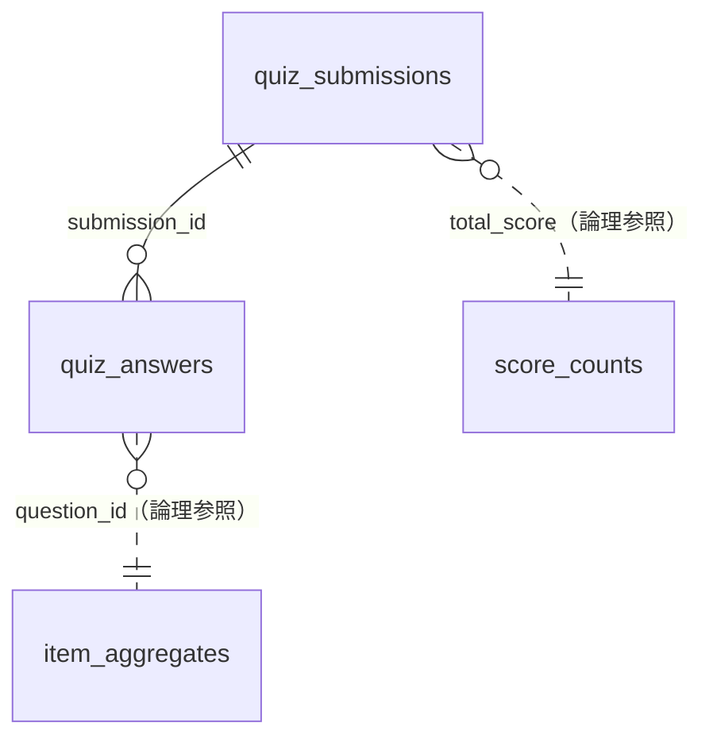

# データベース設計書（Database Design）

Cloudflare D1（エッジ分散型 SQLite）のテーブル構成、インデックス、およびクエリ仕様を定義します。
正となる定義は `migrations/` 配下の SQL（`0001` → `0002` → `0003` の順に適用）です。

---

## 1. 概要

- データベース名: `bukka-now-db`（バインディング名 `DB`、設定は `wrangler.toml`）
- ユーザー登録はないため、個人を識別する情報は保存しない。
- 保存するのは「診断1回分の結果」「設問ごとの回答」「設問別の集計」「総合スコアの分布」の4種類。
- **未回答は保存しない**。時間切れで入力がなかった設問は、0点として採点するが、回答ログ・設問別集計には入れない。
- **集計対象（`in_range`）**: 正解の 1/5〜5倍の回答だけを、世間平均・最低値・最高値に使う。範囲外の回答も回答ログには保存し、回答数と分布には含める（[6. 集計対象と集計の作り直し](#6-集計対象と集計の作り直し)）。
- 世間平均・分布・回答者数は、D1 に入っている回答から作る。コードや migration に値を直接書いたシードは入れない。
- 実ユーザーの回答に加えて、生成スクリプトで作った架空の回答者の回答（**生成データ**）も同じテーブルに入れ、集計に含める。`quiz_submissions.source` で区別する（[5. 生成データ](#5-生成データsynthetic)）。



---

## 2. テーブル設計

### 2.1 `quiz_submissions`（診断セッションログ）

クイズ1回ごとの結果（匿名）。件数がそのまま「累計回答者数」になる。

| カラム名 | 型 | 制約 | 説明 |
| :--- | :--- | :--- | :--- |
| `id` | TEXT | PRIMARY KEY | 実ユーザー: `sub_<epochミリ秒>_<ランダム7文字>` / 生成データ: `syn_<バッチ epochミリ秒>_<連番4桁>` |
| `total_score` | INTEGER | NOT NULL | 総合スコア（0〜100） |
| `sense_type` | TEXT | NOT NULL | タイプコード（`master` / `timeslip` / `panic` / `rough`） |
| `bias_score` | REAL | NOT NULL | 平均バイアス（回答と正解の比率の対数の平均。正なら高め・負なら安め）。2026-10-11 に相対誤差の平均から変更し、`db:rescore` で計算し直す |
| `source` | TEXT | NOT NULL DEFAULT `'user'` | データの出どころ。`user`: 実ユーザー（API 経由）/ `synthetic`: 生成データ。0002 で追加 |
| `question_count` | INTEGER | | 出題数（未回答を含む）。総合スコアを計算し直すときの分母。0003 で追加（既存行は 0円の行を消す前の回答ログの行数で埋めた） |
| `created_at` | DATETIME | DEFAULT CURRENT_TIMESTAMP | 受信日時（生成データは投入した時刻） |

インデックス: `idx_submissions_source(source)`

### 2.2 `quiz_answers`（設問別回答ログ）

| カラム名 | 型 | 制約 | 説明 |
| :--- | :--- | :--- | :--- |
| `id` | INTEGER | PRIMARY KEY AUTOINCREMENT | 内部ID |
| `submission_id` | TEXT | NOT NULL, FK → `quiz_submissions(id)` ON DELETE CASCADE | セッションID |
| `question_id` | TEXT | NOT NULL | 設問ID（`s` ＋ 銘柄符号。例: `s1001`、量に換算した品目は `s1407-200g`。2026-10-11 以前の旧問題は `q1`〜`q100`） |
| `user_answer` | REAL | NOT NULL | 回答金額（円） |
| `error_rate` | REAL | NOT NULL | 相対誤差率 `|回答 - 正解| / 正解`（小数3桁） |
| `score` | INTEGER | NOT NULL | 設問スコア（0〜100）。**採点した時点の式**による（2026-10-11 の採点式の変更で書き換えていない。現在の式での値は `user_answer` から出し直す） |
| `in_range` | INTEGER | NOT NULL DEFAULT 1 | 集計対象か。1: 正解の 1/5〜5倍、0: 範囲外。0003 で追加 |
| `created_at` | DATETIME | DEFAULT CURRENT_TIMESTAMP | 回答日時 |

インデックス: `idx_answers_question_id(question_id)`、`idx_answers_submission_id(submission_id)`

- 未回答の行はない（0003 で過去の 0円の行を削除し、以後は保存しない）。
- `idx_answers_question_id` の中身は `(question_id, rowid)` の順に並ぶ。`WHERE question_id = ? ORDER BY id DESC LIMIT 500` はこのインデックスを後ろからたどり、500件で読み止める（並べ替えをしない）。

### 2.3 `item_aggregates`（設問別集計サマリー）

設問ごとの回答数・世間平均・最低値・最高値を、回答ログを読まずに返すためのテーブル。回答を受け取るたびに UPSERT で更新する。回答ログから作り直せる（`scripts/db/rebuild_aggregates.sql`）。

| カラム名 | 型 | 制約 | 説明 |
| :--- | :--- | :--- | :--- |
| `question_id` | TEXT | PRIMARY KEY | 設問ID |
| `total_responses` | INTEGER | DEFAULT 0 | 累計回答数（集計対象外も含む。未回答は含まない） |
| `in_range_responses` | INTEGER | NOT NULL DEFAULT 0 | 集計対象の回答数。0003 で追加 |
| `sum_answers` | REAL | DEFAULT 0 | 集計対象の回答金額の合計（0003 から。それ以前は全回答の合計） |
| `average_answer` | REAL | DEFAULT 0 | `sum_answers / in_range_responses`（対象がなければ 0。API は `null` として扱う） |
| `min_answer` | REAL | | 集計対象の回答の最低値（対象がなければ NULL）。0003 で追加 |
| `max_answer` | REAL | | 集計対象の回答の最高値（対象がなければ NULL）。0003 で追加 |
| `updated_at` | DATETIME | DEFAULT CURRENT_TIMESTAMP | 最終更新日時 |

### 2.4 `score_counts`（総合スコアの分布）

総合スコア（0〜100点）ごとの診断の回数。「上位何%」の算出と累計回答者数に使う。0003 で追加。最大101行なので、診断が増えても読み取り量は増えない。

| カラム名 | 型 | 制約 | 説明 |
| :--- | :--- | :--- | :--- |
| `total_score` | INTEGER | PRIMARY KEY | 総合スコア |
| `submissions` | INTEGER | NOT NULL DEFAULT 0 | そのスコアだった診断の回数 |

累計回答者数は `SUM(submissions)`（`quiz_submissions` の件数と一致する）。

---

## 3. 主要クエリ

| 用途 | 発行元 | クエリ概要 | 読み取り行数の目安 |
| :--- | :--- | :--- | :--- |
| 設問別の集計値 | `GET /api/quiz`, `GET /api/stats` | `SELECT ... FROM item_aggregates` | 設問数（約110） |
| 同上（出題分だけ） | `POST /api/quiz/submit` | `SELECT ... FROM item_aggregates WHERE question_id IN (...)` | 出題数 |
| スコア分布・累計回答者数 | 3つとも | `SELECT total_score, submissions FROM score_counts` | 最大101 |
| 分布用の過去回答 | `POST /api/quiz/submit`（設問ごとに1文） | `SELECT user_answer FROM quiz_answers WHERE question_id = ? ORDER BY id DESC LIMIT 500` | 設問あたり最大500前後 |
| セッション保存 | `POST /api/quiz/submit` | `INSERT INTO quiz_submissions (id, total_score, sense_type, bias_score, question_count)` | — |
| スコア分布の更新 | 同上 | `INSERT INTO score_counts ... ON CONFLICT(total_score) DO UPDATE SET submissions + 1` | — |
| 回答保存 | 同上（回答した設問ごと） | `INSERT INTO quiz_answers (..., in_range)` | — |
| 集計更新 | 同上（回答した設問ごと） | `INSERT INTO item_aggregates ... ON CONFLICT(question_id) DO UPDATE`。回答数 +1。集計対象なら対象数・合計・平均・最低値・最高値も更新 | — |

- 読み取り系（集計値・スコア分布・設問ごとの過去回答）は `db.batch()` で1往復にまとめる。
- 保存系クエリ（2 + 回答した設問数 × 2 文）は `db.batch()` で1トランザクションにまとめて実行する。
- `IN (...)` のバインド変数は最大100個（出題数の上限）。D1 の1クエリあたりのバインド上限（100）に収まる。

---

## 4. マイグレーション運用

- ファイルの置き場所: `migrations/`（`wrangler.toml` の `migrations_dir`）
- 適用コマンド:
  - ローカル: `npm run db:migrate:local`
  - 本番: `npm run db:migrate:remote`
- スキーマ変更は既存ファイルを書き換えず、`0004_xxx.sql` のように新しいファイルを追加する。

| ファイル | 内容 |
| :--- | :--- |
| `0001_initial_schema.sql` | 3テーブルとインデックスの作成（データなし） |
| `0002_add_submission_source.sql` | `quiz_submissions.source` と `idx_submissions_source` の追加。既存行は `user` になる |
| `0003_in_range_and_score_counts.sql` | `quiz_submissions.question_count` を追加して出題数を記録。0円（未回答）の回答ログを削除。`quiz_answers.in_range`、`item_aggregates` の `in_range_responses` / `min_answer` / `max_answer`、`score_counts` を追加し、集計を作り直す。適用後に `npm run db:refresh:*` で範囲外の印を付ける |

---

## 5. 生成データ（synthetic）

架空の回答者の回答を `scripts/synthetic-data/generate.ts` で生成し、実ユーザーと同じテーブルに入れている。手順は [scripts/synthetic-data/README.md](../../scripts/synthetic-data/README.md)。

- **見分け方**: `quiz_submissions.source = 'synthetic'`、ID が `syn_` で始まる。`quiz_answers` は `submission_id` で `quiz_submissions` と結合して判別する。
- **集計への反映**: 画面に出る値（累計回答者数・設問別回答者数・世間平均・分布・最低値・最高値）には生成データも含まれる。API は `source` を見ていない。
- **投入済み**: 2026-10-11 に本番・ローカルの両方へ 500人 × 100問（回答50,000行、seed `20261011`）を投入した。その後、実ユーザーに近い外れ方で回答の値を上書きした（`npm run synthetic:regenerate:*`、seed `20261012`。行は残す）。

```sql
-- 実ユーザーだけの件数
SELECT COUNT(*) FROM quiz_submissions WHERE source = 'user';

-- 実ユーザーだけの設問別平均
SELECT a.question_id, COUNT(*), AVG(a.user_answer)
FROM quiz_answers a JOIN quiz_submissions s ON s.id = a.submission_id
WHERE s.source = 'user'
GROUP BY a.question_id;
```

- **削除**: `scripts/synthetic-data/delete.sql` で生成データの回答とセッションを消し、続けて `scripts/db/rebuild_aggregates.sql` で集計を作り直す（`npm run synthetic:delete:*` が両方を実行する）。実ユーザーの行には触れない。
- **書き込み量に注意**: D1 はインデックスへの書き込みも1行と数える。回答1件は「本体＋インデックス2つ」で3行になり、500人 × 100問の投入・削除はどちらも約15万行になる。無料プランの上限（1日10万行）を1回で超える（2026-10-11 に実際に超えた）。

---

## 6. 集計対象と集計の作り直し

### 6.1 集計対象（`in_range`）

- 判定は `server/aggregation.ts` の `isInRange`（正解の 0.2〜5倍、両端を含む）。API・生成データ・作り直しスクリプトで同じ関数を使う。
- 目的: 桁の打ち間違い（×10・÷10）やいたずらの極端な値（例: 200円の品目に 99,999,999円）で、世間平均・最低値・最高値が大きく動かないようにする。範囲外の値は回答ログに残るので、分布グラフと回答数には出る。

### 6.2 作り直し

| ファイル / コマンド | 内容 | いつ使う |
| :--- | :--- | :--- |
| `scripts/db/rebuild_aggregates.sql` | `item_aggregates` と `score_counts` を回答ログ・診断ログから作り直す | 生成データの投入・削除のあと（各スクリプトが自動で実行） |
| `npm run db:rescore:local` / `:remote` | `scripts/db/rescore.ts` が全診断の総合スコア・バイアス・タイプを現在の採点式で計算し直し（変わる行だけ UPDATE）、続けて上の作り直しを実行する。`quiz_answers.score` は書き換えない | 採点式（`scoreQuestion`）や正解価格を変えたとき |
| `npm run db:refresh:local` / `:remote` | `scripts/db/refresh.ts` で設問ごとの `in_range` 付け直し SQL を生成し、続けて上の作り直しを実行する | migration 0003 の適用直後 / 範囲（`server/aggregation.ts`）や正解価格を変えたとき |

- 付け直しは、判定が変わる行だけを UPDATE する（書き込み行数を抑えるため）。2026-10-11 時点のデータでは約500行。
- 作り直しの読み取りは全回答数ぶん（約5万行）。書き込みは設問数＋スコアの種類数ぶん（数百行）。
