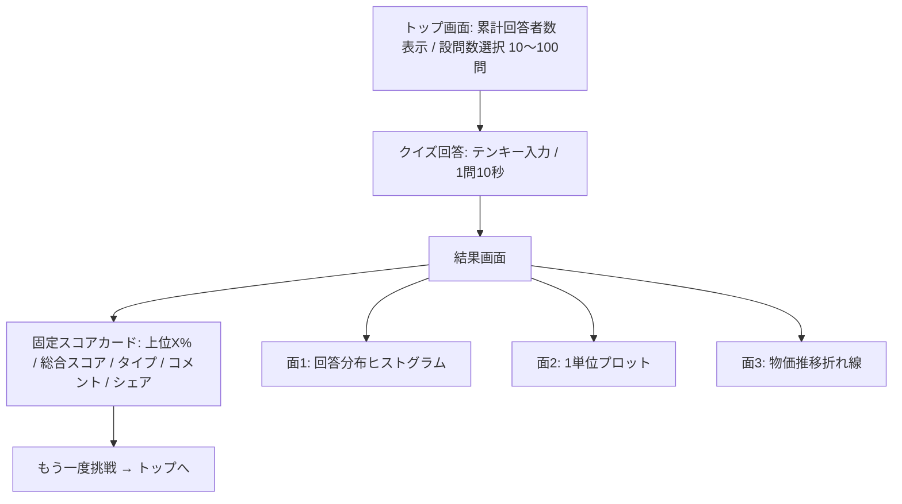

# サービス要件定義書（Service Overview & Requirements）

`bukka_now`（物価意識調査WEBサービス）のサービス概要、ユーザー体験、機能要件、およびシステム仕様を定義します。
本書は**現行仕様**を表します。仕様変更時は本書を上書きし、経緯は [decisions.md](decisions.md) に追記してください。

---

## 1. サービス概要・コンセプト

- **サービス名**: `bukka_now`
- **キャッチコピー**: 「あなたの物価感覚、令和のいま合っていますか？ 相場感覚リアルタイム診断」
- **コンセプト**:
  インフレや原材料高で急速に変化する商品・サービスの価格相場について、ユーザーがテンキーで価格（円）を直接回答する。自身の物価意識が「上位何%」かを、全ユーザーの回答分布や公的相場と比較しながら診断できる。
- **本番URL**: https://bukka-now.miiiwa.com

---

## 2. デザインポリシー

- **絵文字は一切使用しない**（UI・テキスト・診断結果・シェア文面すべて）。
- **unpis.net 風のミニマルなイラストレーション調 UI**（ライトテーマ）。
  - 背景はエクリュ（生成り）、カードは白、線と文字は墨黒。
  - 均一な 2px の黒アウトライン。**影（box-shadow / text-shadow）は使わない**。
  - 差し色: ポピーレッド `#eb4634`（主要アクション）、コバルトブルー（あなたの回答）、リーフグリーン（正解）、マスタードイエロー（世間平均）。
  - フォント: `Outfit` ＋ `Noto Sans JP`。
- **シンプル is best**: 冗長な説明文・装飾的なフィーチャーカードは置かない。
- **フッター**（トップ画面・結果画面。クイズ回答中は表示しない）: 白カード・2px 黒枠で、以下を表示する。
  - 開発者: X `@miiiwa3330`（https://x.com/miiiwa3330 ）、GitHub `@miiiwa3330`（https://github.com/miiiwa3330/ ）へのリンク。氏名は出さない
  - ソースコード: GitHub リポジトリ `miiiwa3330/bukka_now` へのリンク
  - 価格の出典: 総務省統計局「小売物価統計調査」（公式ページへのリンク）、東京都区部の年平均価格
  - 注記: 正解価格は東京都区部の2025年平均（一部は全国統一価格）で地域や店舗によって異なること、回答は個人を特定しない形で集計されること
  - コピーライト: © 2026 bukka_now

---

## 3. ユーザー体験フロー（UX Flow）

### 3.1 トップ画面
- 会員登録・ログイン不要。
- サービス全体の**累計回答者数**（`quiz_submissions` の件数）を表示。
- 設問数を 10〜100問（10問刻み、デフォルト10問）から選び、スタート。

### 3.2 クイズ回答画面
- 答えはすべて「数字（円）」。
- 画面上のテンキー（0〜9 / C / BS / OK）、または物理キーボード（0〜9 / Backspace / Enter）で入力。
- 各問に「世間の平均予想」は出さず、**その設問の回答者数**を表示。
- **1問あたり10秒の制限時間**。ゲージでカウントダウンし、残り3秒以下で赤色パルス警告を出す。0秒になると、その時点の入力値（未入力なら0円）で自動確定し、次の問題へ進む。
- 全問回答後に採点 API を呼び、結果画面へ遷移。

### 3.3 結果画面
上部に**独立固定のスコアカード**、その下に**3面の横スライドボード**を置く。

**固定スコアカード**
- 「上位 X.X %」（パーセンタイル）をヒーロー表示。総合スコア（0〜100点）も併記。
- 物価感覚タイプ（4種）。
- スコア帯別の辛口コメント（100点・0点の特別枠＋5点刻み、全22段階）。
- アクション: 「Xでポストする」「結果をコピー」「もう一度挑戦する」。

**スライドボード（3面）**
- 切り替え方法: 矢印ボタン、タッチスワイプ、マウスドラッグ、トラックパッドの二本指横スワイプ。
- 3面で各設問カードの高さを揃えている。そのため、横に移動しても同じ設問が同じ縦位置に来る。
- 各設問カードの最下部に「コラム」（価格の背景解説 `priceNote`）を置く。3面とも内容は同じ。
- 各面の最下部に「もう一度挑戦する」ボタンを置く。

| 面 | 内容 |
| :--- | :--- |
| 面1: 回答分布 | 設問ごとのメトリクス（あなたの回答 / 正解 / 全体平均 / 最低値 / 最高値）と、10分割の横棒ヒストグラム。該当ビンを色分けし、値が重なるビンは斜めストライプで示す。凡例はグラフタイトルの横、背景に目盛りの縦グリッド線 |
| 面2: 1単位プロット | メトリクス（あなたの回答 / 正解 / 全体平均 / 中央値）と、全回答者の生回答値を1円単位で集計した縦棒グラフ。パネル・凡例・配色・目盛りグリッド線は面1と共通 |
| 面3: 物価推移 | メトリクス（あなたの回答 / 正解 / 全体平均 / 最古の年の価格）と、小売物価統計調査の年平均価格の推移の折れ線グラフ（最長1950〜2025年。補間値は使わない）。パネル・目盛りグリッド線は面1・面2と共通（凡例なし）。グラフ上を押す・なぞると、最も近い年の価格を「1973年 1,234円」「現在 4,928円」の形で吹き出し表示する（初期表示は最新年） |

---

## 4. クイズ仕様

- **回答形式**: すべて金額（円）の数値入力。
- **出題プール**: 100問（`src/data/quizMaster.ts`）。すべて総務省「小売物価統計調査」の公表値で、正解は **東京都区部の2025年平均価格**（郵便・NHK受信料・新聞・映画の5問は全国統一価格）。統計で確認できない価格（特定チェーンのメニュー価格など）は出題しない。
- **設問の単位**: 普段の買い物で目にする単位で聞く（例: 「もやし1袋（200g）はいくら？」「牛丼（並・店内）はいくら？」「卵（10個入りパック）はいくら？」）。肉や魚は店頭の値札と同じ100g。「1kgあたり」のような業者向けの単位は使わない。
- **設問の前提表示**: クイズ画面の設問文の下に「東京都区部・2025年平均（総務省 小売物価統計調査）」のように地域・年・出典を表示する。
- **出題**: 指定数をプールからランダム抽出。
- データの生成方法・品目一覧は [design/quiz_data.md](../design/quiz_data.md) を参照。

| カテゴリ | コード | 品目数 |
| :--- | :--- | ---: |
| 食料品 | `food` | 44 |
| 外食 | `dining` | 17 |
| 日用品・医薬品 | `daily` | 11 |
| 衣料・家電・文具・おもちゃ | `goods` | 11 |
| 光熱・交通・通信 | `infrastructure` | 9 |
| サービス・娯楽 | `service` | 8 |

--- | :--- | ---: |
| 食料品 | `food` | 48 |
| 外食 | `dining` | 13 |
| 光熱・交通・通信・住居 | `infrastructure` | 11 |
| 衣料・耐久財・文具 | `goods` | 10 |
| 日用品・医薬品 | `daily` | 9 |
| サービス・娯楽 | `service` | 9 |

--- | :--- | ---: |
| 食料品・生鮮・加工・飲料 | `food` | 35 |
| 外食・カフェ・ファストフード | `dining` | 20 |
| 日用品・消耗品・ヘルスケア | `daily` | 15 |
| 光熱・生活インフラ・通信 | `infrastructure` | 10 |
| サービス・エンタメ・レジャー | `service` | 10 |
| 家電・家具・日用耐久財 | `goods` | 10 |

---

## 5. スコアリング・診断仕様（概要）

詳細な計算式は [design/quiz_data.md](../design/quiz_data.md) を参照。

- **設問スコア**: 相対誤差率 0% で 100点、40% 以上で 0点（線形）。
- **総合スコア**: 出題全問の設問スコアの平均（0〜100点）。
- **上位何%**: 正規分布モデル（μ=65, σ=16）から算出。表示範囲は 0.5〜99.5%。
- **物価感覚タイプ**: 総合スコアと平均バイアス（安く見積もりがちか、高く見積もりがちか）から4タイプに分類。
  - リアルタイム相場マスター / 過去価格タイムスリップ型 / インフレ過敏型 / 大らか直感型
- **世間平均・回答分布・最低値・最高値・回答者数**: D1 に入っている回答から集計する（コードに値を書いたモックは使わない）。実ユーザーの回答に加えて、生成スクリプトで投入した架空の回答者500人分（生成データ）も含む。生成データは `quiz_submissions.source = 'synthetic'` で実ユーザーと区別できる。

---

## 6. 非機能要件

- **認証**: なし（匿名・ゲストプレイ）。個人情報は収集しない。
- **カンニング防止**: 正解価格と、正解のヒントになる値（過去価格、世間平均）は、回答の送信前にはクライアントへ渡さない。採点はサーバー側で行い、マスターデータはクライアントバンドルに含めない。
- **入力検証**: 回答送信 API は、設問ID、重複、金額範囲（0〜99,999,999円の整数）を検証する。不正な送信で集計が汚れるのを防ぐ。
- **対応環境**: PC（マウス・トラックパッド・物理キーボード）とスマートフォン（タッチ）。
- **インフラ**: Cloudflare Workers（Static Assets ＋ Hono）＋ D1。構成は [design/architecture.md](../design/architecture.md) を参照。

---

## 7. 未実装・将来検討

- SNS シェア用の OGP 画像生成
- 設問カテゴリの追加と、マスター価格の定期更新運用
- `GET /api/stats`（全体統計）を使った画面（API は実装済みだが、フロントエンドからは未使用）
