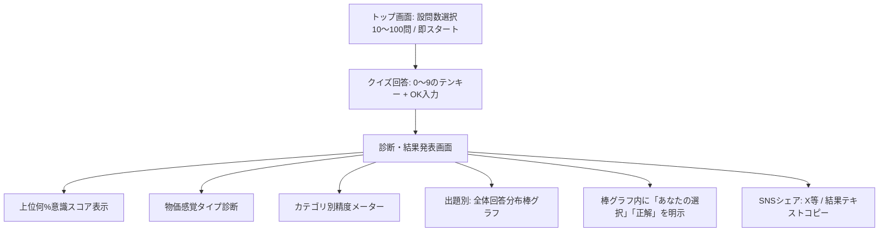
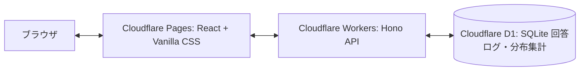

# サービス要件定義書（Service Overview & Requirements）

`bukka_now`（物価意識調査WEBサービス）のサービス概要、ユーザー体験、機能要件、およびシステム仕様を定義します。

---

## 1. サービス概要・コンセプト

- **サービス名**: `bukka_now`
- **キャッチコピー**: 「あなたの物価感覚、令和のいま合っていますか？ 相場感覚リアルタイム診断」
- **コンセプト**:
  近年、インフレや原材料高に伴い急速に変化する商品・サービスの価格相場。ユーザーがテンキー（0〜9の数字＋OK）で価格を直接回答することで、自身の物価意識が「上位何％」かを測定し、全体ユーザーの回答分布棒グラフや実際の公的価格と比較しながら客観的に診断できるWEBサービス。
- **デザインポリシー**:
  全体として絵文字を一切排除し、シャープで洗練されたフィンテックUIを採用。

---

## 2. ユーザー体験フロー（UX Flow）

1. **アクセス & 設問数選択**:
   - 会員登録やログイン不要。
   - 10問〜100問（10問刻み: 10, 20, 30, ... 100問）から希望の長さを選択可能（デフォルト10問）。
2. **テンキー入力型クイズ回答**:
   - 答えは必ず「数字（円）」。
   - 画面上の0〜9の数字キー、クリア（C）、バックスペース（BS）、決定（OK）によるテンキーパッドでダイレクト入力。
   - 物理キーボード（0〜9, Backspace, Enter）にも対応。
3. **診断結果画面**:
   - 「上位 X.X %」のパーセンタイル意識スコアをヒーロー表示。
   - 各設問について「全体の回答分布棒グラフ（ヒストグラム）」をリアルタイム描画し、「あなたの選択」「正解相場」をプロット。
   - 絵文字を使わない洗練された共有カード。

---

## 3. クイズ仕様（全問テンキー数値回答型・100問マスター）

- **回答形式**: すべて具体的な金額数値（円）。
- **出題プール**: 総務省「小売物価統計調査」や主要大手チェーンの公表価格に基づく厳選100品目マスター。
- **出題カテゴリ**:
  - 食料品・生鮮（卵、牛乳、食パン、米、野菜、肉、魚、調味料等 35品目）
  - 外食・カフェ（ハンバーガー、牛丼、ラーメン、うどん、カレー、ファミレス等 20品目）
  - 日用品・消耗品（ティッシュ、トイレットペーパー、洗剤、シャンプー、マスク等 15品目）
  - 光熱・生活インフラ（電気代、ガス代、水道代、スマホ料金、光回線、ガソリン、切手等 10品目）
  - サービス・レジャー（映画料金、銭湯、テーマパーク、カット代、クリーニング等 10品目）
  - 家電・生活家具（テレビ、電子レンジ、ドライヤー、ベッド、衣料等 10品目）

---

## 4. スコアリング＆診断ロジック仕様

### 4.1 総合スコア（0〜100点）
- 各問における「実勢相場価格（正解値）$T$」と「ユーザー回答 $A$」の相対誤差率 $E = \frac{|A - T|}{T}$ をベースに算出。
- スコア $S = \max(0, \min(100, \text{round}(100 \times (1 - E / 0.4))))$。誤差率0%で100点、40%以上で0点。
- 総合得点は出題全問の平均値。

### 4.2 上位何%スコア（パーセンタイル表示）
- 全回答者母集団モデル（正規分布 $\mu=65, \sigma=16$）に基づき、累積正規分布から上位何%かを精密算出。
- 例: 100点 = 上位 1.4%、90点 = 上位 5.9%、80点 = 上位 17.4%、65点 = 上位 50.0%、50点 = 上位 82.6%。

### 4.3 物価感覚タイプ判定（絵文字不使用）
回答の全体バイアス値 $\frac{1}{N} \sum \frac{A_i - T_i}{T_i}$ から判定：
- **リアルタイム相場マスター**: 総合80点以上。誤差が極めて少なく最新相場を正確に把握。
- **過去価格タイムスリップ型**: 総合80点未満 かつ バイアス $\le -0.08$。実際より安めに見積もる傾向。
- **インフレ過敏型**: 総合80点未満 かつ バイアス $\ge +0.08$。実際より過度に高めに見積もる傾向。
- **大らか直感型**: 上記以外。品目ごとの感覚にバラツキがあるタイプ。

### 4.4 全体ユーザー回答分布棒グラフ（リアルタイム更新）
- 各設問ごとに、正解価格を基準とした5つの価格帯区間（ビン）で度数分布を集計。
- 棒グラフ内に「あなたの選択」「正解（公的相場）」のインジケーターを明示。

---

## 5. システム・技術アーキテクチャ（Cloudflare Native）

- **フロントエンド**: React (TypeScript / Vite)
  - Vanilla CSS（ネオ・フィンテック、ダークテーマ、絵文字不使用）
  - テンキーパッドコンポーネント（0〜9, C, BS, OK）
  - 全体回答分布棒グラフコンポーネント
- **バックエンド API**: Hono (TypeScript) on Cloudflare Pages / Workers
  - `GET /api/quiz?count=10`: 10〜100問の指定数抽出
  - `POST /api/quiz/submit`: 回答採点、上位%計算、回答分布集計、D1 への非同期保存
  - `GET /api/stats`: 全体統計
- **データベース**: Cloudflare D1（分散型 SQLite）
